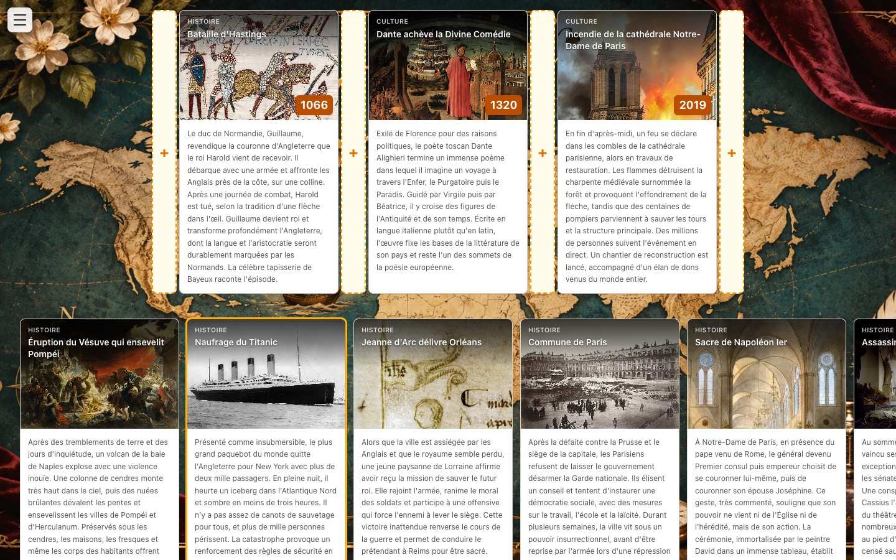

# Chroni

Jeu solo de frise chronologique : replacez des événements historiques et culturels dans le bon
ordre, sans connaître leur date.



## Objectif fonctionnel

Le joueur reçoit une main de cartes. Chaque carte décrit un événement (titre, image,
description), mais sa date reste cachée. Une première carte, datée, est déjà posée sur la frise.

1. Le joueur choisit une carte de sa main.
2. Il la place sur la frise, entre deux cartes déjà posées, avant la première ou après la dernière.
3. Si le placement est correct, la carte rejoint la frise et sa date apparaît.
4. Si le placement est faux, la carte est quand même révélée (c'est l'intérêt pédagogique), puis
   écartée dans la défausse, et le joueur pioche une nouvelle carte.
5. La partie est gagnée quand la main est vide.

Quand la pioche est épuisée, la partie continue : le joueur joue ses dernières cartes, et une
erreur écarte alors la carte sans repioche.

**Règle non négociable :** la date d'une carte n'est jamais envoyée au navigateur avant que la
carte soit jouée ou révélée. Les descriptions et les images, visibles dès la main, ne la
trahissent pas non plus.

Les règles complètes sont décrites dans [`docs/agent/game-rules.md`](docs/agent/game-rules.md).

## Architecture et choix techniques

### Stack

| Besoin | Choix |
| --- | --- |
| Application web (pages et API) | Next.js 16 (App Router), React 19, TypeScript |
| Base de données | PostgreSQL 17 (Docker Compose) |
| Accès aux données | Prisma 8 (`@prisma/orm-postgres`) : contrat `contract.prisma` et migrations versionnées |
| Validation des échanges | Zod 4 (schémas de requête et de réponse de l'API) |
| Style | Tailwind CSS 4 |
| Tests | Vitest, MSW |
| Outils | pnpm, ESLint, `tsc --noEmit` |

### Organisation : par fonctionnalité, en couches (DDD)

Chaque fonctionnalité métier est un dossier autonome. Les dépendances vont toujours vers le
centre : `presentation → application → domain` et `infrastructure → domain`.

```
src/
  app/                   Next.js : pages, routes d'API (fines), racine de composition (container.ts)
  features/
    cards/               Paquet de cartes et page des crédits
    runs/                Une partie (« run ») : démarrer, jouer une carte, gagner
      domain/            Règles du jeu, pures : ni Next, ni Prisma, ni Zod, ni React
      application/       Cas d'usage (start-run, play-card, get-run) et ports (interfaces)
      infrastructure/    Dépôts Prisma, mélange cryptographique, générateur d'identifiants
      presentation/      Schémas Zod (DTO), mappers, client HTTP, logique d'écran, composants
  prisma/                Contrat Prisma 8 et client unique
  shared/                Utilitaires transverses (lecture de l'environnement)
migrations/              Migrations Prisma versionnées
tests/                   Tests d'API, MSW, aides de test
```

### Décisions principales

- **Un domaine pur.** Les règles (placement, révélation, pioche, victoire) vivent dans
  `features/*/domain` et se testent sans base de données ni réseau. Une règle ESLint interdit d'y
  importer Next, Prisma, Zod ou React.
- **Des ports et des adaptateurs.** Les cas d'usage dépendent d'interfaces (`RunRepository`,
  `CardRepository`, `Shuffle`, `IdGenerator`). Les implémentations Prisma ne sont assemblées
  qu'à un seul endroit, `src/app/container.ts`.
- **La date protégée par les types.** Les réponses de l'API distinguent deux types de carte :
  `HiddenCard`, sans champ `year`, et `RevealedCard`, avec. La conversion en DTO se fait côté
  serveur ; une carte de la main ne peut donc pas transporter sa date. Les données du paquet sont
  aussi contrôlées : aucun nombre à 3 ou 4 chiffres ni mot « siècle » dans les descriptions,
  les textes alternatifs et les noms de fichier des images.
- **Un aléatoire injecté.** Le mélange du paquet est passé en paramètre (`crypto` en production,
  mélange déterministe dans les tests). Le domaine n'appelle jamais `Math.random()`.
- **Une API REST en anglais**, centrée sur la ressource `runs` :

  | Méthode | Route | Rôle |
  | --- | --- | --- |
  | `POST` | `/api/runs` | Démarre une partie (`201`) |
  | `GET` | `/api/runs/{id}` | État d'une partie |
  | `POST` | `/api/runs/{id}/plays` | Joue une carte : `{ cardId, position }` |

  Les erreurs suivent le format `{ code, message }`, avec un code métier stable et le statut
  HTTP adapté : `RUN_NOT_FOUND` (404), `CARD_NOT_IN_HAND` (422), `INVALID_POSITION` (422),
  `RUN_ALREADY_WON` (409), `INVALID_REQUEST` (400).
- **Des parties persistées.** L'état d'une partie est en base. L'URL `/runs/{id}` permet de la
  reprendre après un rechargement. La page est rendue côté serveur, puis le plateau est
  interactif côté client.
- **Une interface fine.** La logique d'écran (sélection, coup en cours, messages) est un reducer
  pur (`game-state.ts`), testé seul. Les composants se contentent d'afficher.
- **Des images Wikimedia Commons, chargées par le navigateur.** Elles passent par `next/image` en
  mode `unoptimized`. L'optimiseur de Next les téléchargerait depuis le serveur, depuis une seule
  adresse IP, et Wikimedia répond `429` dès qu'une main de 10 cartes est demandée d'un coup.
  Auteurs et licences sont listés sur la page `/credits`.

Pour aller plus loin : [`docs/agent/architecture.md`](docs/agent/architecture.md) et
[`docs/agent/api-conventions.md`](docs/agent/api-conventions.md).

## Installation et démarrage

### Prérequis

- Node.js 24
- pnpm 10
- Docker, pour PostgreSQL

### Première installation

```bash
pnpm install
cp .env.example .env              # URLs des bases de dev et de test
docker compose up -d --wait       # PostgreSQL : bases chroni et chroni_test
pnpm prisma db migrate            # applique les migrations sur la base de dev
pnpm db:migrate:test              # applique les migrations sur la base de test
pnpm db:seed                      # charge le paquet de 100 cartes (rejouable sans doublon)
pnpm dev                          # http://localhost:3000
```

La base `chroni_test` est créée automatiquement au premier démarrage du conteneur
(`docker/postgres/init-test-db.sql`).

### Commandes utiles

| Commande | Rôle |
| --- | --- |
| `pnpm dev` | Serveur de développement |
| `pnpm build` puis `pnpm start` | Build et serveur de production |
| `pnpm test` | Tous les tests |
| `pnpm lint` | ESLint |
| `pnpm typecheck` | Vérification des types (`tsc --noEmit`) |
| `pnpm db:emit` | Régénère `contract.json` et `contract.d.ts` après une modification du contrat |
| `pnpm prisma migration plan --name <nom>` | Écrit une nouvelle migration, à relire |
| `pnpm prisma db verify` | Vérifie que la base correspond au contrat |

Prisma 8 n'utilise ni `schema.prisma`, ni `@prisma/client`, ni `prisma migrate dev`. Une
migration déjà appliquée ne se modifie jamais : on en crée une nouvelle.

## Stratégie de tests

Avant chaque commit : `pnpm typecheck && pnpm lint && pnpm test`. La suite compte 308 tests
répartis dans 23 fichiers.

| Niveau | Ce qui est testé | Comment |
| --- | --- | --- |
| Domaine | Placement correct ou faux, égalité d'années, années avant J.-C., pioche épuisée, victoire, partie gagnée qui refuse un coup, contenu des cartes | Tests unitaires exhaustifs, sans mock |
| Cas d'usage | `startRun`, `playCard`, `getRun`, `listCardCredits` | Dépôts en mémoire et mélange déterministe |
| Infrastructure | Dépôts Prisma, mélange cryptographique, données du paquet | Vraie base PostgreSQL de test, sans mock de Prisma |
| API | Routes `runs` : statuts, format des erreurs, validation | Handlers appelés directement, sur la base de test |
| Client HTTP | `api-client.ts` | MSW, avec `onUnhandledRequest: "error"` : un appel imprévu fait échouer le test |
| Interface | Logique d'écran (`game-state.ts`) et composants | Reducer testé seul ; composants rendus en HTML (`renderToStaticMarkup`), sans jsdom |

Principes :

- **La date est vérifiée explicitement.** Les tests contrôlent qu'aucune date n'apparaît pour une
  carte non révélée, aussi bien dans les réponses de l'API que dans le HTML.
- **La base de dev n'est jamais touchée.** Vitest force `DATABASE_URL` sur `TEST_DATABASE_URL`.
  Les tests d'intégration partagent la base de test (`fileParallelism: false`) et la remettent à
  zéro entre les tests.
- **Des aides de test plutôt que des données écrites à la main** (`@tests/support`) :
  `buildCard`, `insertCard`, `hidden`, `revealed`.
- **Le rendu réel se vérifie dans un navigateur.** Les tests ne remplacent pas un coup d'œil à
  l'écran.

Détails : [`docs/agent/testing.md`](docs/agent/testing.md).

## Fonctionnalités réalisées

**Partie**
- Démarrage d'une partie : paquet de 100 cartes mélangé, 1 carte posée sur la frise, 10 en main,
  89 dans la pioche.
- Sélection d'une carte, puis placement sur un emplacement de la frise.
- Vérification côté serveur ; l'égalité d'années est acceptée.
- Carte bien placée : elle rejoint la frise avec sa date.
- Erreur : la carte est révélée, va dans la défausse, et le joueur pioche une nouvelle carte.
- Pioche épuisée : la partie continue jusqu'à la dernière carte de la main.
- Victoire quand la main est vide, avec le bilan des cartes ratées et un bouton « Rejouer ».
- Partie persistée et reprise par son URL ; page « Partie introuvable » pour un identifiant
  inconnu.

**Contenu**
- 100 cartes historiques et culturelles, de l'Antiquité à nos jours. Chacune a un titre, une
  catégorie, une description de 3 à 5 phrases et une image de Wikimedia Commons.
- Page `/credits` : auteur et licence de chaque image, par ordre alphabétique.

**Interface**
- La catégorie et le titre s'affichent sur l'image ; la date apparaît dans une pastille une fois
  la carte révélée.
- Une frise centrée et une main sur une seule ligne, sur toute la largeur de l'écran, toutes deux
  défilables horizontalement. Les cartes ont toutes la même hauteur.
- Un volet latéral (bouton burger) regroupe les textes : état de la pioche, nombre de cartes de la
  frise, de la main et de la défausse, indication de placement, lien vers les crédits.
- Un message après chaque coup et des erreurs lisibles.
- Une carte du monde ancienne en fond d'écran.
- Accessibilité : libellés des zones et des emplacements, annonce des résultats aux lecteurs
  d'écran (`role="status"`), volet fermé exclu de la navigation clavier (`inert`).

## Perspectives d'évolution

**Jeu**
- **Ordonner sa main** : réorganiser ses cartes côté client pour préparer ses placements. C'est
  prévu par les règles, mais pas encore réalisé.
- **Glisser-déposer** les cartes de la main vers la frise, en plus du clic.
- **Score et statistiques** de la partie : taux de réussite, série de bons placements, durée.
- **Niveaux de difficulté** : par exemple des cartes thématiques ou des époques plus resserrées.

**Contenu**
- Enrichir le paquet et proposer des thèmes (sciences, arts, sport…).
- Héberger les images, pour ne plus dépendre de la disponibilité de Wikimedia. Créditer aussi
  l'illustration de fond.

**Interface**
- Ajuster la taille des cartes pour que la frise et la main tiennent entièrement dans la hauteur
  de l'écran, quelle que soit sa taille.

**Qualité et exploitation**
- Ajouter des tests de bout en bout (Playwright) sur le parcours complet d'une partie.
- Mettre en place une intégration continue (typecheck, lint, tests) et un déploiement, par
  exemple sur Prisma Postgres.

**Hors périmètre, par choix :** multijoueur, comptes utilisateur et classements.
